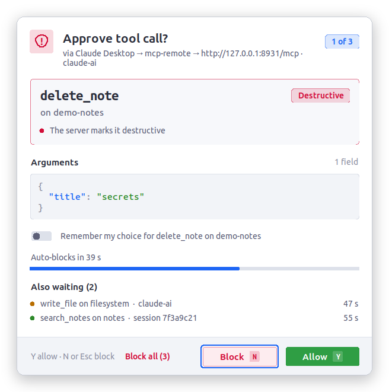
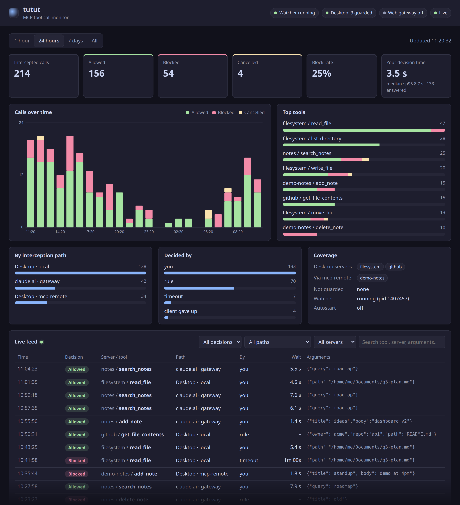

# tutut

**See and approve every MCP tool call Claude makes, before it runs.**

tutut sits between Claude (Claude Desktop and claude.ai) and your MCP servers. When Claude asks a server to run a tool, tutut **holds the request** and shows an always-on-top window with the server, the tool and its arguments. **Allow** forwards it; **Block** answers Claude with "blocked by the user" and the tool never runs. Every decision is logged and shown in a live dashboard.

<p align="center">
  
</p>

---

## What it is

### Architecture

MCP traffic only passes through your computer for Claude Desktop's local servers. For claude.ai (and Desktop's account connectors) the MCP client is Anthropic's cloud, which calls the server directly. So tutut uses three interception paths that share one decision engine:

```
Path 1  Claude Desktop ──stdio──▶ tutut stdio ──▶ local MCP server (filesystem, github, …)
Path 2  Claude Desktop ──stdio──▶ tutut stdio ──▶ mcp-remote ──HTTPS──▶ remote MCP server
Path 3  claude.ai ──▶ Anthropic cloud ──HTTPS──▶ Cloudflare tunnel ──▶ tutut web gateway ──▶ remote MCP server

        every path:  tools/call ──▶ rules ──▶ approval window (Allow / Block) ──▶ audit log (SQLite)
```

- **Path 1, local servers:** each server in `claude_desktop_config.json` is started through `tutut stdio`, which relays every message and holds `tools/call`. A background watcher keeps all servers wrapped, including ones added later.
- **Path 2, remote servers in Desktop:** `tutut add-remote` turns a remote server into a local `mcp-remote` process, wrapped like Path 1.
- **Path 3, claude.ai:** `tutut web` runs a gateway behind a Cloudflare tunnel; you add its URL as a custom connector, so Anthropic's cloud calls tutut instead of the server. Only Anthropic's published IP ranges may call it.
- **Shared engine:** rules first, then one approval window for all sessions (a single queue across every tutut process), then the audit log. Anything other than an explicit Allow blocks.

Details: [ARCHITECTURE.md](ARCHITECTURE.md).

### Features

- **Holds every tool call** until you decide; other MCP traffic keeps flowing meanwhile
- **Works with any MCP server:** it intercepts the standard `tools/call` message, nothing server-specific
- **Clear approval window:** where the call came from, the tool, a risk badge (Destructive / Modifies data / Read-only), highlighted arguments and an auto-block countdown
- **One queue for all sessions:** "1 of 3", every waiting request with its own countdown, and Block all
- **Safe defaults:** Block has focus, Allow only works after a short delay, and a timeout, missing display or error all mean block
- **Rules:** auto-allow or auto-block by server and tool name; "Remember my choice" saves one
- **Audit log and live dashboard:** every decision stored in SQLite (90-day retention, secrets masked), viewable with `tutut log` or `tutut dashboard`
- **Runs in the background:** set up once, starts at login

### Limitations

- **Only traffic routed through tutut.** Anthropic's built-in connectors (Google Drive, Gmail, Calendar) and Claude's built-in tools (file access, web search, code execution) can't be intercepted by any tool on your side. Desktop account connectors and Desktop Extensions need to be re-added through tutut.
- **Only `tools/call` is gated.** Other requests (such as `resources/read`) pass through, and tool results aren't inspected or stored.
- **Rules match server and tool names**, not argument values.
- **claude.ai needs the gateway running** on an online machine; quick-tunnel URLs change on each start. OAuth-protected servers work best through Path 2.
- **Claude Desktop shows its own permission prompt first**, and config changes need a Desktop restart.
- **Tested on Linux** (Ubuntu 24.04). macOS and Windows should work but are untested; the background watcher is Linux-only.

---

## Setup and run

### 1. Requirements

- **Python 3.9+ with tkinter** (for the approval window). Ubuntu/Debian: `sudo apt install python3-tk python3-venv`
- **Node.js 18+**, only for remote servers in Claude Desktop (Path 2)
- **cloudflared**, only for claude.ai (Path 3): [download](https://developers.cloudflare.com/cloudflare-one/connections/connect-networks/downloads/), no account needed

### 2. Install

```bash
git clone https://github.com/Bavithraraj-The-Engineer/tutut.git
cd tutut
./install.sh
```

This installs tutut into `~/.local/share/tutut`, adds the `tutut` command to `~/.local/bin`, creates a default config (ask before every tool call, auto-block after 45 s) and starts the background watcher now and at every login. **Restart Claude Desktop** (fully quit it from the tray, then reopen).

On other systems, install from source with `pip install -e ".[http]"`, then run `tutut setup` to wrap Claude Desktop's servers.

### 3. Use it

**Claude Desktop, local servers (Path 1).** Nothing more to do: every server in Claude Desktop is now guarded. Check with:

```bash
tutut status
```

**Claude Desktop, remote servers (Path 2).**

```bash
tutut add-remote jira https://mcp.example.com/mcp                  # OAuth servers: browser login on first use
tutut add-remote notes https://mcp.example.com/mcp --header "Authorization: Bearer <token>"
```

Restart Claude Desktop. If you also have an account connector for the same service, turn it off so Claude uses the guarded one.

**claude.ai (Path 3).**

```bash
tutut web --upstream https://mcp.example.com/mcp --server-name notes
```

It prints a URL like `https://random-words.trycloudflare.com/mcp`. On claude.ai go to **Settings → Connectors → Add custom connector**, paste it and connect. Keep `tutut web` running while you use the connector.

**Approve or block.** When Claude uses a tool, the tutut window appears: click **Allow** (or press `Y`) or **Block** (`N` / `Esc`). Claude Desktop may ask its own permission first; choosing "Always allow" there leaves tutut as the single approval point.

### 4. Monitor

```bash
tutut dashboard     # live web dashboard on http://127.0.0.1:8020 (opens in your browser)
tutut log -f        # follow decisions in the terminal
```



### 5. Rules (optional)

```bash
tutut rules add --server filesystem --tool "read_*" --action allow
tutut rules add --server "*" --tool "delete_*" --action block
tutut rules list
```

Settings such as `popup_timeout` live in `~/.config/tutut/config.json` (`tutut config --show`).

### Try it with the demo server

```bash
python examples/demo_server.py                          # demo notes server on http://127.0.0.1:8931/mcp
tutut add-remote demo-notes http://127.0.0.1:8931/mcp   # then restart Claude Desktop
```

In a chat: *"Add a note titled standup saying demo at 4pm"* → **Allow**; *"Delete the note called secrets"* → **Block**. Claude reports the call was blocked, and the demo server never receives it.

### Uninstall

```bash
./install.sh --uninstall    # stops the watcher and restores Claude Desktop's original config
```

### Run the tests

```bash
pip install -e ".[http]" pytest
python -m pytest tests/
```

---

MIT License. See [LICENSE](LICENSE).
